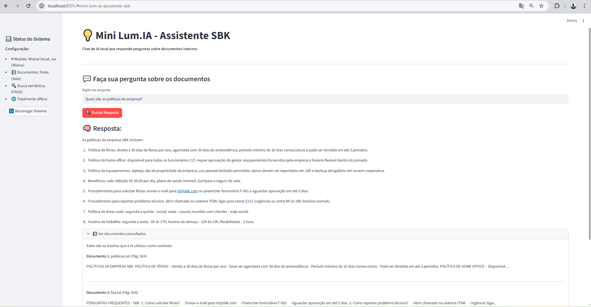

# Mini Lum.IA — Assistente RAG Local

Sistema de perguntas e respostas (Q&A) baseado em documentos locais usando a arquitetura RAG (Retrieval-Augmented Generation). O projeto funciona de forma 100% offline e privada, utilizando o **Ollama** com o modelo **Mistral**, sem envio de dados para APIs externas.



---

## Como Funciona

1. **Leitura e Processamento:** Lê arquivos `.pdf` e `.txt` colocados na pasta `data/`.
2. **Chunking & Embeddings:** Divide o conteúdo em blocos de texto e gera vetores usando `OllamaEmbeddings(model="mistral")`.
3. **Busca Semântica:** O **FAISS** indexa os vetores e recupera os trechos mais relevantes para a dúvida do usuário.
4. **Geração de Resposta:** O modelo **Mistral** local recebe a pergunta junto com o contexto recuperado e gera uma resposta precisa, citando a fonte.

---

## Tecnologias

| Ferramenta | Papel no Projeto |
| :--- | :--- |
| **Python** | Linguagem base |
| **Streamlit** | Interface web simples e interativa |
| **LangChain** | Orquestração da chain de RetrievalQA e loaders |
| **Ollama** | Servidor local do modelo Mistral |
| **FAISS** | Banco vetorial em memória para busca semântica |

---

## Pré-requisitos

1. **Python 3.10+**
2. **Ollama** instalado no computador.
   - Baixar e rodar o modelo Mistral:
     ```bash
     ollama pull mistral
     ```
   - Iniciar o servidor do Ollama (caso não esteja rodando em segundo plano):
     ```bash
     ollama serve
     ```

---

## Como Rodar o Projeto

1. **Clone o repositório:**
   ```bash
   git clone https://github.com/alexleonec6/Mini_lum.IA-sbk.git
   cd Mini_lum.IA-sbk
   ```

2. **Crie e ative um ambiente virtual:**
   ```bash
   # Windows
   python -m venv venv
   .\venv\Scripts\activate

   # Linux/macOS
   python3 -m venv venv
   source venv/bin/activate
   ```

3. **Instale as dependências:**
   ```bash
   pip install -r requirements.txt
   ```

4. **Adicione seus documentos:**
   - Coloque seus arquivos `.pdf` ou `.txt` dentro da pasta `data/`.
   - O projeto já vem com um arquivo de exemplo (`data/exemplo.txt`) para testes imediatos.

5. **Inicie o Streamlit:**
   ```bash
   streamlit run app.py
   ```
   A aplicação abrirá no navegador no endereço `http://localhost:8501`.

---

## Estrutura do Repositório

```text
Mini_lum.IA-sbk/
├── data/              # Pasta onde ficam os PDFs e TXTs para consulta
│   └── exemplo.txt
├── app.py             # Interface gráfica feita em Streamlit
├── chat_engine.py     # Lógica do RAG (leitura, chunking, FAISS e LLM)
├── requirements.txt   # Dependências do projeto
├── image.png          # Demonstração da interface
└── README.md
```
